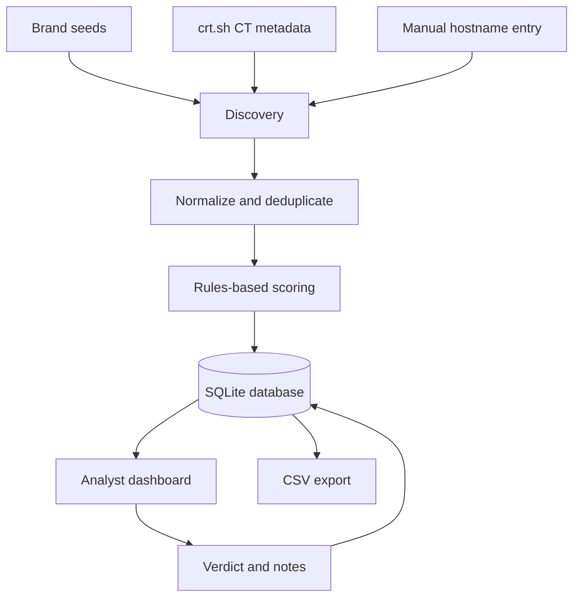

# Architecture

## MVP boundaries

- The CT adapter reads public certificate metadata only; it does not fetch discovered websites.
- Scoring is deterministic and version-light; a score is not a calibrated probability.
- The current implementation omits page fetch, screenshots, passive DNS integrations, and ML.
- The web UI is intended for local use only because it does not yet include authentication or CSRF protection.

## Main modules

| Module | Responsibility |
|---|---|
| `app/main.py` | Routes, form handling, dashboard, verdict updates, export |
| `app/database.py` | SQLite persistence and table definitions |
| `app/normalization.py` | Hostname normalization and PSL-aware registrable-domain extraction |
| `app/discovery.py` | Bounded CT metadata lookup with error handling |
| `app/scoring.py` | Explainable signal contributions and tier assignment |
| `app/templates/` | Dashboard and analyst review templates |
| `app/static/style.css` | Responsive interface styling |

## Candidate lifecycle

1. A candidate is entered manually or discovered from CT metadata.
2. The hostname is canonicalized and deduplicated per brand.
3. The scoring module returns a numeric score, tier, and the reason for each contribution.
4. Evidence is persisted in SQLite.
5. An analyst records a verdict and notes.
6. Findings can be exported as CSV for a report or offline evaluation.
