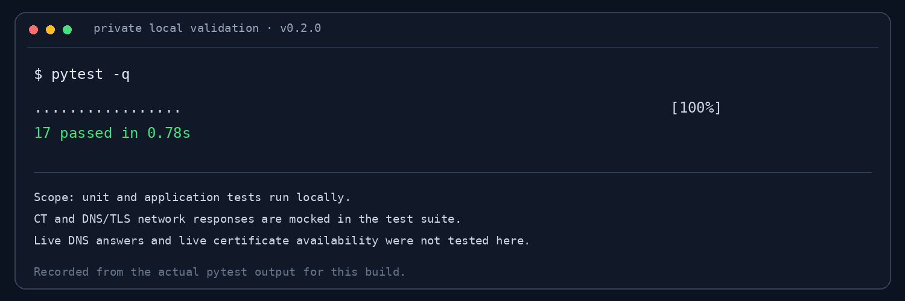

# Subdomain Typosquatting Detection Platform

A local defensive security tool for finding and reviewing hostnames that may imitate a monitored brand. It searches Certificate Transparency metadata, assigns a rules-based triage score, stores analyst decisions, and now collects DNS and TLS observations on demand.

**Version:** 0.2.0
**Stack:** Python, FastAPI, SQLite, Jinja2, dnspython, and TLS support from Python's standard library

This is a student project and an early MVP, not a complete phishing-detection service. The score is a prioritization aid, not a probability or proof that a site is malicious.

## Features

- Add brands, official domains, and keywords to monitor.
- Add candidate hostnames manually or discover candidates through a low-volume `crt.sh` lookup.
- Normalize hostnames and handle IDN/punycode. Public Suffix List parsing is used when `tldextract` is installed.
- View the signals behind a rules-based score and record analyst verdicts.
- Run DNS lookups for A, AAAA, CNAME, MX, NS, TXT, CAA, and SOA records.
- Save DNS answers, resolver details, TTLs, collection timestamps, and source information.
- Inspect verified TLS certificate metadata, including subject, issuer, SANs, validity dates, fingerprint, TLS version, cipher, and connection IP.
- Keep previous enrichment runs in SQLite and export the finding queue to CSV.

DNS/TLS checks are started manually from a candidate's detail page. The app does not fetch HTML, open login pages, submit forms, or query a passive-DNS history provider.

## Run locally on Linux

These commands work on Parrot OS, Kali, Ubuntu, and similar distributions.

```bash
sudo apt update
sudo apt install -y git python3 python3-venv python3-pip unzip
```

Extract the project and enter its directory. For a ZIP in `~/Downloads`:

```bash
cd ~/Downloads
unzip subdomain-typosquatting-detector-v0.2.0.zip
cd subdomain-typosquatting-detector
```

Create the virtual environment and install dependencies:

```bash
python3 -m venv .venv
source .venv/bin/activate
python -m pip install --upgrade pip
pip install -r requirements.txt
```

Start the app:

```bash
uvicorn app.main:app --reload --host 127.0.0.1 --port 8000
```

Open <http://127.0.0.1:8000>. API documentation is at <http://127.0.0.1:8000/docs>, and the health endpoint is at <http://127.0.0.1:8000/health>.

The first time the app starts, it creates `data/app.db`. That database is local runtime data and should not be published.

## First use

1. Add a monitored brand and its official domain. Use `Acme Demo` and `acme.example` for a harmless first run.
2. Add a candidate such as `acme-login.provider.example`, or use the CT lookup for a brand.
3. Open the candidate details and review the score breakdown.
4. Select **Run DNS + TLS checks** to collect DNS records and inspect the certificate on port 443.
5. Review each observation's timestamp, source, DNS resolver, and status. The detail page keeps the latest run and a short history of previous runs.
6. Record an analyst verdict and export the queue to CSV when needed.

Reserved `.example` names are demonstration values; they are not claims about real sites. They will not produce useful public DNS or TLS results.

## What the enrichment does

### DNS

The app queries the machine's configured recursive resolver through `dnspython`. Each record type stores the observation time, source, resolver information, result status, values, and TTL when returned. Errors such as `NXDOMAIN`, no answer, and timeout are kept as distinct states instead of being treated as evidence that the hostname is safe.

These are current DNS lookups, **not passive DNS history**. Answers can vary by resolver, network, and time. Passive DNS can be added later through a provider account whose terms and access permit this use.

### TLS

The app resolves the hostname first and will only attempt a TLS handshake with a public IP address from those DNS results. It blocks private, loopback, link-local, and reserved addresses. It makes a short connection to port 443, sends no HTTP request, and uses the system CA store to verify the certificate chain and hostname.

For a successful verified handshake, the app stores certificate subject and issuer, serial number, SANs, SHA-256 fingerprint, validity dates, days remaining, TLS version, cipher, observed IP, timestamp, and source. If validation or the handshake fails, the result records a failure status and a brief error category. No certificate details are fabricated when the verified handshake fails.

### Scoring

The existing score still uses hostname similarity, lure-related keywords, selected shared-hosting patterns, punycode indicators, CT source context, and negative evidence for configured official domains. DNS/TLS observations are shown as supporting evidence but **do not yet change the risk score**. That will need a labeled dataset and evaluation before score weights are changed.

The current thresholds are high (80–100), review (50–79), and low (0–49). With the present rules, the maximum possible score is 64, so the high tier is not currently reachable. This is deliberate: weak metadata alone should not create a high-confidence alert.

## Project structure

```text
subdomain-typosquatting-detector/
├── app/
│   ├── main.py              # Web routes and analyst workflow
│   ├── database.py          # SQLite schema and connections
│   ├── discovery.py         # Certificate Transparency lookup
│   ├── enrichment.py        # DNS records and TLS certificate metadata
│   ├── normalization.py     # Hostname normalization and suffix parsing
│   ├── scoring.py           # Rules-based triage score
│   ├── templates/           # Dashboard and candidate detail pages
│   └── static/              # CSS
├── data/                    # Local database; do not publish
├── scripts/                 # Optional demo-data helper
├── docs/images/             # README images
├── ARCHITECTURE.md
├── requirements.txt
└── README.md
```

The automated test suite is kept in the local working copy and excluded from Git. The screenshot below records a private, offline test run; DNS/TLS network calls are mocked in unit tests, so the screenshot is not a claim that live provider access was tested.

## Local validation



The run covers normalization, scoring, CT parsing with mocked responses, web routes, persistence, and basic DNS/TLS safety behavior. Live DNS resolution and certificate availability depend on the network where the app is run.

## Roadmap

- **Next:** improve hostname permutations and provider discovery with explicit query budgets.
- Add optional passive DNS integration when an authorized provider and account are available.
- Add page metadata and favicon/content matching only in an isolated worker with strict timeouts, size limits, egress restrictions, redirect checks, and private-address blocking.
- Build a labeled dataset and measure precision, recall, false positives, missing-data rate, and detection delay.
- Consider machine learning only after enough analyst-reviewed examples exist.

## Safety and privacy

- This build is for local use. It has no authentication or CSRF protection; do not expose it to the public internet. Keep it bound to `127.0.0.1`.
- Only monitor brands you own or are authorized to assess.
- DNS queries use the machine's resolver. TLS enrichment makes a direct handshake to a public IP on port 443, but does not retrieve page content.
- Do not enter credentials, submit forms, exploit candidate sites, or automatically block/report a hostname based on a heuristic score.
- Review data-provider terms and request limits before using external discovery sources.
- The SQLite database may contain hostnames and investigation notes. Keep it private and out of Git.

## References

- [crt.sh](https://crt.sh/) — Certificate Transparency search.
- [dnspython resolver documentation](https://dnspython.readthedocs.io/en/stable/resolver.html) — DNS query behavior and timeout settings.
- [Python SSL documentation](https://docs.python.org/3/library/ssl.html) — certificate and TLS metadata.
- [FastAPI form handling](https://fastapi.tiangolo.com/tutorial/request-forms/) — form processing used in the dashboard.
